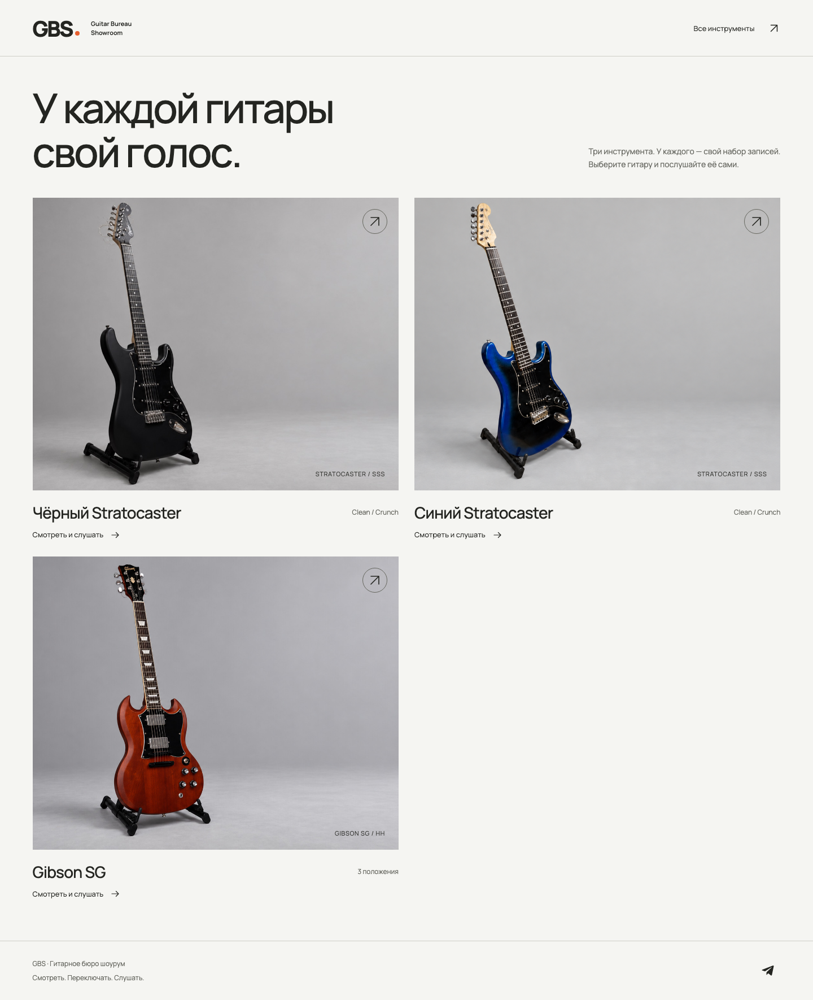
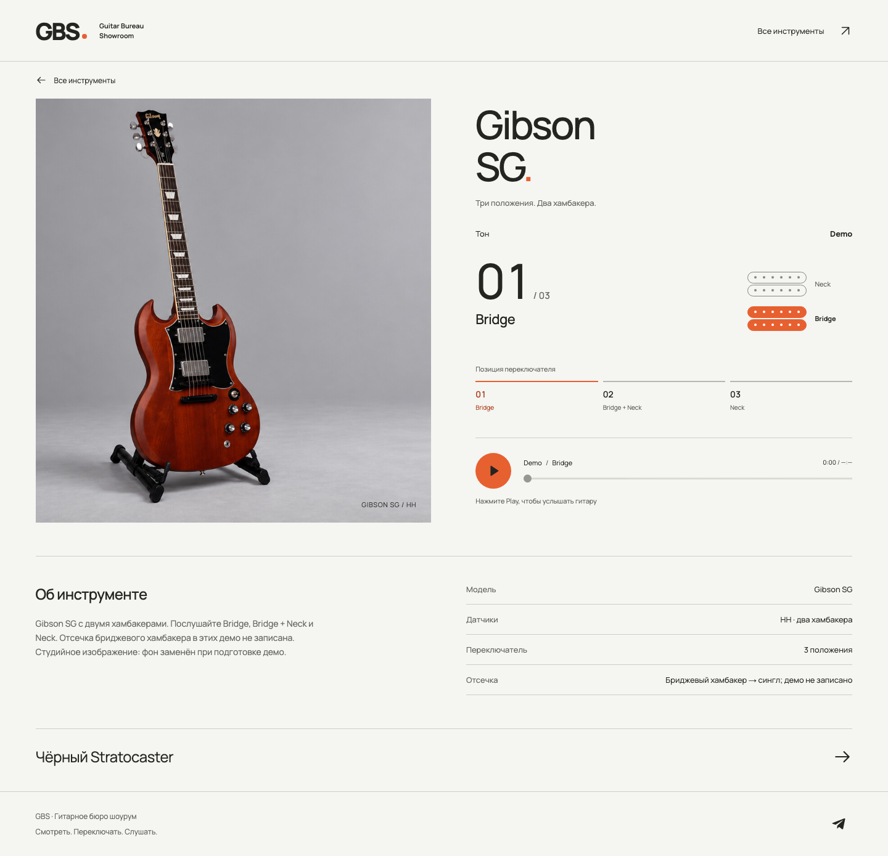
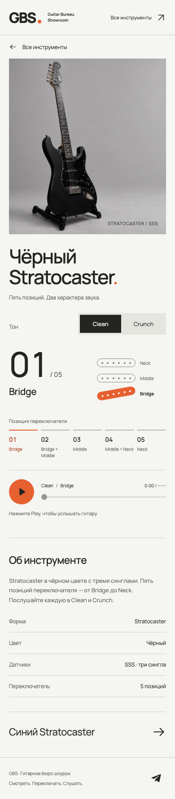

# Guitar Bureau Showroom

Интерактивная витрина гитарных звуков: выберите инструмент, положение переключателя и послушайте запись.

[Открыть демо](https://gbs.adavid.ru)



<details>
<summary>Скриншоты плеера</summary>





</details>

## Возможности

- Три инструмента и отдельные адаптивные страницы.
- 23 записи для сочетаний звукоснимателей и тонов.
- Клавиатурное управление, видимый фокус и доступные подписи элементов.
- Статические страницы и локальные MP3 через HTML Audio.

## Технологии и решения

Nuxt 4, Vue 3, TypeScript, Vitest и Playwright. Данные каталога типизированы и локальны; backend, база данных и учётные записи не нужны. MP3 загружается после нажатия Play. При смене позиции сохраняются время и состояние воспроизведения; смена тона начинает запись заново. Устаревшие события изолированы, ошибку загрузки можно повторить.

## Локально и проверки

Нужен Node.js 24.

```sh
npm ci
npm run dev
```

Статический просмотр после генерации:

```sh
npm run generate
npm run preview
```

Preview работает на `http://127.0.0.1:4173`. Проверки:

```sh
npm run typecheck
npm test
npm run verify:assets
npm run generate
npm run test:e2e
```

Публичный снимок проверен 29 октября 2026 года: typecheck прошёл, 18 unit-тестов, проверка хешей 26 медиафайлов, статическая генерация и 8 Playwright-сценариев завершились успешно. Для браузерных тестов при первом запуске установите Chromium: `npx playwright install chromium`.

## Моя часть проекта

В этом проекте я разрабатывал фронтенд на Nuxt/Vue и TypeScript: модель данных каталога, страницы инструментов, адаптивные компоненты схемы звукоснимателей и плеера. Также реализовал контроль жизненного цикла HTML Audio, переключение записей с сохранением времени и тесты загрузки, ошибок, навигации и воспроизведения.

## Ограничения

Это демонстрационная витрина, не магазин: нет цен, наличия, корзины, оплаты, поиска или личного кабинета. Показаны только подтверждённые характеристики; браузерные проверки не заменяют физические устройства, субъективное прослушивание или полный аудит доступности.

`npm audit` от 29 октября 2026 года обнаружил 23 предупреждения в 20 пакетах (4 low, 6 moderate, 10 high, 3 critical). Production раздаёт статические файлы через nginx без Nuxt/Node-сервера; зависимости остаются задействованы при разработке, сборке, preview и тестах. Это отчёт по пакетам, не полный анализ достижимости.

Разрешение владельца на публикацию включённых фотографий и аудиодемо подтверждено 29 октября 2026 года; отдельная лицензия на повторное использование не предоставляется.
